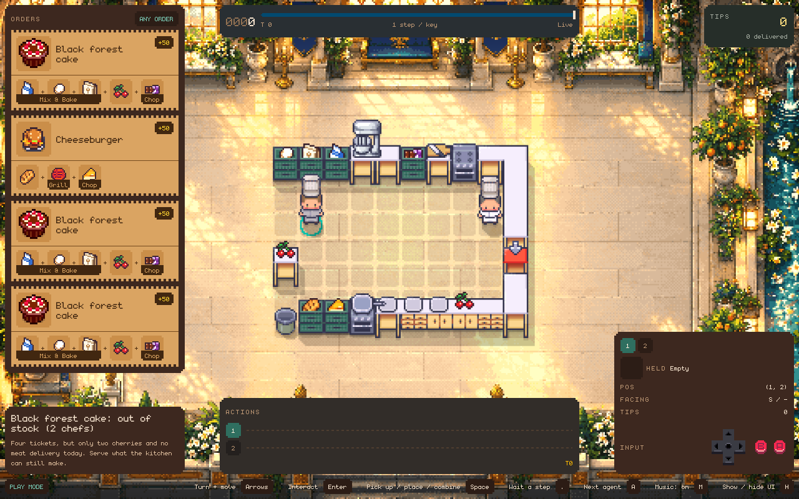
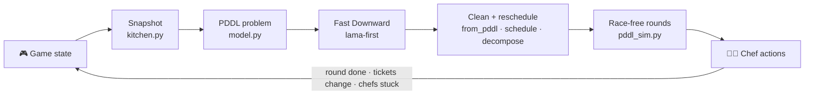

<div align="center">

# 🍳 Too Many Chefs — Multi-Agent PDDL Planner

**Up to four AI chefs plan, cook and deliver together in an Overcooked-style kitchen.**


-orange)




| 🏆 Score | ✅ Kitchens completed | 🍽️ All orders served | ⚔️ Best 2v2 win |
|:---:|:---:|:---:|:---:|
| **3662 → 4076** | **36 / 36** | **34 / 36** | **717 – 0** |

[Results](#-results) · [Overview](#-overview) · [Architecture](#-architecture) · [Theory](#-theory) · [Features](#-key-features) · [Run it](#-running-locally)

</div>

---

## 📊 Results

### Levels 1–3 (36 practice kitchens)

| | First version | Final version |
|---|:---:|:---:|
| Total score | 3662 | **4076** |
| Kitchens completed | 33 / 36 | **36 / 36** |
| Every order delivered | – | **34 / 36** |

> One of the two kitchens that miss orders is *out of stock* on purpose. It only has ingredients for 2 of its 4 orders, and the agent serves both.

### Level 4 (2v2 match)

| Opponent | Our team | Their team |
|---|:---:|:---:|
| Example team | **717** | 0 |
| Our chef + example teammate vs example team | **439** | 0 |
| My previous version (3 sets) | **252 / 303 / 270** | 190 / 175 / 181 |

No missed ticks and no crashes across all matches.

<div align="center">


</div>

---

## 🧭 Overview

Chefs share a grid kitchen. They fetch ingredients, chop, cook, plate and deliver orders before each ticket runs out. Recipes, station layouts and chef counts change from kitchen to kitchen.

Each kitchen comes with real constraints:

| Constraint | Why it is hard |
|---|---|
| 👨‍🍳 **Up to 4 chefs** | Every chef runs its own action queue in parallel |
| 🧱 **Divided kitchens** | Some chefs can only pass food across a counter |
| 🔥 **Timed cooking** | Meat burns if nobody takes it off the pan in time |
| 🍽️ **Scarce items** | Only a few plates, pans or ingredients for the whole game |
| ⏱️ **200 ms per tick** | In the 2v2 match, against another team in the same kitchen |

---

## 🏗️ Architecture

The agent plans at the **task level in PDDL** and leaves walking to the provided path-finding.



> 💡 **Key insight:** lama-first is fast but ignores action costs, so it happily sends a chef across the room. Instead of changing the solver, I shaped the model. Each chef only sees nearby storages, stations and counters, and the plan is improved afterwards with a makespan local search. Most of the score gain came from this, not from the planner itself.

---

## 📐 Theory

<details>
<summary><b>Click to expand the maths behind the planner</b></summary>

### 1. Planning problem

Each planning cycle builds a classical planning task

```math
\Pi = \langle F,\ A,\ s_0,\ G \rangle
```

- $F$: facts, such as `(holding chef food)`, `(food_at tile food)`, `(reach chef tile)`
- $A$: task-level actions (pick up, place, chop, cook, plate, deliver)
- $s_0$: the current kitchen state
- $G$: the chosen orders are delivered

A plan is a sequence $\pi = \langle a_1, \dots, a_n \rangle$, where each $a_k \in A$ is done by chef $c(a_k)$. The plan is valid if applying it from $s_0$ reaches a state where $G$ holds.

### 2. Choosing orders

Let $O$ be the visible orders, $t$ the current tick, $\ell_o$ the deadline of order $o$ and $\hat{T}(o)$ an estimate of the ticks needed to cook it. We plan

```math
O^{*} = \text{the } k \text{ most urgent orders in } \lbrace\, o \in O \mid o \text{ is makeable},\ t + \hat{T}(o) \le \ell_o \,\rbrace
```

with $k \le 3$ and at most about 14 recipe steps in total, so the solver stays fast.

### 3. Distance without action costs

With $d(p, q)$ the walking distance, chef $i$ at position $p_i$ only sees storages of food $f$ with

```math
d(p_i, s) \le \min_{s'} d(p_i, s') + \delta
```

where the minimum is over storages $s'$ of food $f$ and $\delta$ is a small slack. For two chef areas $R_i$ and $R_j$, the hand-off counter is

```math
h_{ij} = \arg\min_{x \in R_i \cap R_j} \big( d(p_i, x) + d(p_j, x) \big)
```

### 4. Action elimination

```math
\pi \setminus a_k \text{ is valid and reaches } G \ \Rightarrow\ \pi \leftarrow \pi \setminus a_k
```

### 5. Makespan estimate

```math
S_k = \max \Big( E_{\text{prev}(k)} + d\big(\text{pos}_{\text{prev}(k)}, \text{pos}_k\big),\ \max_{j \in \text{dep}(k)} E_j \Big)
```

```math
E_k = S_k + \tau(a_k), \qquad M(\pi) = \max_k E_k
```

- $\text{prev}(k)$: the chef's previous step
- $\text{dep}(k)$: earlier steps by other chefs that $a_k$ needs, for example food passed on a counter
- $\tau(a_k)$: the action time, such as chopping presses or cook time

### 6. Local search

Moves $m$ reassign a step to another chef, move a job, or reorder how a plate collects its parts (hill climbing):

```math
\pi \leftarrow m(\pi) \quad \text{if } m(\pi) \text{ is valid and } M\big(m(\pi)\big) < M(\pi)
```

### 7. Race-free rounds

Let $\text{obj}(a)$ be the counters and stations step $a$ touches. Chef $i$'s queue is cut before the first step $a_k$ where

```math
\exists\, j < k:\ c(a_j) \ne c(a_k) \ \land\ \text{obj}(a_j) \cap \text{obj}(a_k) \ne \emptyset
```

and $a_j$ is not yet done. Inside a round, no two chefs use the same object out of plan order.

### 8. Receding horizon

```math
\text{replan} \iff \text{round done} \ \lor\ O_t \ne O_{t-1} \ \lor\ \text{no chef moved for } N \text{ ticks}
```

with $N = 15$ in Levels 1–3 and $N = 12$ in the 2v2 match.

</details>


---

## ✨ Key Features

| | Feature | What it does |
|:---:|---|---|
| 🧩 | **One domain for every kitchen** | Recipe rules are generated as static facts from each level file, so one `overcooked.pddl` covers every kitchen |
| 📍 | **Distance without action costs** | Each chef only sees the nearest storages, stations, counters and hand-off points |
| ⚙️ | **Post-plan optimisation** | Action elimination drops detours. A makespan local search swaps work between chefs and reorders plating |
| 🚦 | **Race-free parallel execution** | The plan is replayed in PDDL and cut into rounds wherever two chefs would race for the same station |
| 🔥 | **Burn catcher on duty** | Before meat goes into a timed pan, a chef with a plate must be ready to catch it |
| ⚔️ | **Real-time 2v2 controller** | Uses up to 160 ms of its 200 ms budget to wait for the plan, routes around other chefs, and leaves orders others are working on |

---

## 🔍 How it works

```
get_actions()
│
├── should_replan()  ← round done, tickets changed, or chefs stuck
│     │
│     ├── kitchen.py       → Snapshot of the game
│     ├── model.py         → pick orders, prune areas, write PDDL problem
│     ├── Fast Downward    → lama-first plan
│     ├── from_pddl.py     → action elimination
│     ├── decompose.py     → split orders between groups of chefs
│     ├── schedule.py      → makespan local search
│     └── pddl_sim.py      → replay + cut into race-free rounds
│
└── each chef pops its next step → path-finding → move / interact
```

📚 More detail:
- [Architecture](docs/architecture.md)
- [Debugging journey](docs/debugging-journey.md): 10 real failures and how I fixed them
- [Level 4](docs/level4.md)

---

## 📁 Project Structure

```
├── src/controllers/
│   ├── pddl/submission/      # Levels 1–3 planner
│   │   ├── overcooked.pddl   # PDDL domain
│   │   ├── kitchen.py        # game state → Snapshot
│   │   ├── model.py          # Snapshot → PDDL problem
│   │   ├── from_pddl.py      # plan → chef actions
│   │   ├── schedule.py       # makespan local search
│   │   ├── decompose.py      # cell splitting
│   │   └── pddl_sim.py       # PDDL replay checker
│   └── open/submission/      # 2v2 match controller
├── docs/                     # architecture, debugging, Level 4, images
├── results/                  # raw runs and CSVs
└── scripts/                  # run all kitchens, summarise matches
```

---

## 🚀 Running locally

Requires the Too Many Chefs starter repository (not included here).

```bash
# copy the controllers into the starter repo
cp -r src/controllers/pddl/submission <starter>/controllers/pddl/
cp -r src/controllers/open/submission <starter>/controllers/open/
cd <starter> && uv sync --extra fast-downward --extra native

# run one kitchen with the viewer
uv run cook agent --level levels/2_overcooked/3_0_sushi_rush_hour_3p.yaml

# run a 2v2 match against the example team
uv run cook match --seat . --seat . --seat example --seat example

# run every practice kitchen
bash <this repo>/scripts/run_levels.sh
```

---

## 🧠 What I learned

- **Shape the model, not just the solver.** Classical planners are fast but not optimal. Pruning and fixing the plan afterwards mattered more than the solver.
- **Parallel needs a safety layer.** A correct plan can still deadlock when agents run at different speeds.
- **Measure before trusting an idea.** A "teammate prediction" change sounded good but made no difference over 10 matches, so I removed it.

---

## 🛠️ Tech

`Python` · `PDDL` · `Fast Downward (LAMA)` · `Local Search` · `Multi-Agent Planning`

<sub>The simulator, level files and starter controllers come from the Too Many Chefs starter code (MIT licence). The planning model, problem generator, plan post-processing, execution layer and match controller in `src/` are my own work.</sub>
