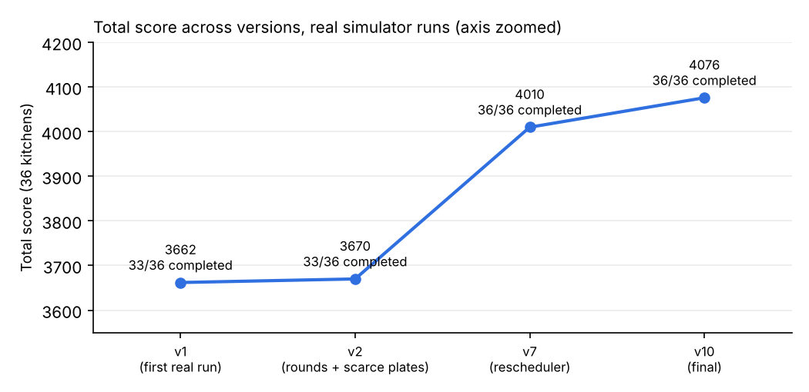
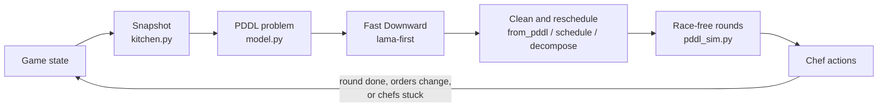

# Too Many Chefs: multi-agent kitchen planner

A planning controller for **Too Many Chefs**, an Overcooked-style cooking
simulator. Up to four chefs share a grid kitchen. They fetch ingredients, chop,
cook, plate and deliver orders before their deadlines. My controller models the
kitchen in **PDDL**, solves it with **Fast Downward**, then improves and safely
executes the plan for every chef at once.

It also plays the **2v2 match mode**, where it drives one chef against another
team under a 200 ms per-tick limit.



## Results

Measured on the real simulator, across the 36 practice kitchens in three
difficulty levels:

| | First version | Final version |
| --- | --- | --- |
| Total score | 3662 | **4076** |
| Kitchens completed (no give-up or crash) | 33 / 36 | **36 / 36** |

In the final version, 34 of 36 kitchens deliver every order. One of the other
two is *out of stock* on purpose: it only has ingredients for 2 of its 4
orders, and the controller serves both. Full
per-kitchen numbers are in [`results/`](results/).

In 2v2 matches (two games of 300 ticks, 200 ms per tick) it beat the example
team in every set, by up to **717–0**. The final version also beat my previous
version in 3 of 3 sets. It never missed a tick or crashed. See [Level 4](docs/level4.md).

## How it works



1. **Task-level PDDL model.** Chefs pick up, place, chop, cook, plate and
   deliver. Walking is left to the provided path-finding. One domain covers
   every kitchen, because all recipe rules are generated as static facts from
   the level file.
2. **Distance without action costs.** Lama-first ignores action costs, so I
   prune the model instead. Each chef only sees nearby storages, stations,
   counters and hand-off points.
3. **Post-plan optimisation.** Action elimination removes detours. A local
   search on estimated makespan reassigns work between chefs and reorders how a
   dish is collected on its plate. In kitchens with two full sets of stations,
   it also splits the orders between groups of chefs.
4. **Safe parallel execution.** Each chef runs its own queue, so I replay the
   plan in PDDL and cut it into rounds wherever two chefs would race for the
   same counter or station.
5. **Receding horizon.** It plans a few orders at a time and replans when a
   round ends, the tickets change, or the chefs get stuck.

More detail is in [Architecture](docs/architecture.md).

## Engineering highlights

Most of the gains came from reading real failures, not from guessing. Some
examples, with the full story in
[Debugging journey](docs/debugging-journey.md):

- **Race between chefs.** Two chefs used the same cutboard out of plan order,
  and the kitchen deadlocked. Fixed by replaying plans and splitting them into
  race-free rounds.
- **Navigation deadlock.** Four chefs crowded one pot, and the starter path
  policy crashed. Fixed by giving each chef a local working area, plus a
  one-chef-per-round rule at dead-end stations.
- **Burning meat.** Meat went into a timed pan with nobody ready to catch it.
  Fixed with a "catcher on duty" rule that survives replanning.
- **The 2v2 host does not wait.** The game advances as soon as every seat
  answers, so planning in the background let the game race ahead. Fixed by
  using the 200 ms budget to wait for the planner.

## Repository layout

```
src/controllers/pddl/submission/   Levels 1-3: plans for every chef
src/controllers/open/submission/   2v2 match controller (planner/ is a copy)
docs/                              architecture, debugging journey, Level 4
results/                           per-kitchen results and match results
scripts/                           run all kitchens, summarise matches
```

## Running it

This code plugs into the Too Many Chefs starter repository, which is not
included here. From a checkout of that repository:

```bash
cp -r path/to/this/repo/src/controllers/pddl/submission controllers/pddl/
cp -r path/to/this/repo/src/controllers/open/submission controllers/open/
uv sync --extra fast-downward --extra native

uv run cook agent --level levels/2_overcooked/3_0_sushi_rush_hour_3p.yaml
uv run cook match --seat . --seat . --seat example --seat example
bash path/to/this/repo/scripts/run_levels.sh
```

## What I learned

- Classical planners are fast but not optimal. Most of the score came from
  shaping the model (pruning, generated rules) and from fixing the plan
  afterwards, not from changing the solver.
- Multi-agent execution needs its own safety layer. A valid plan can still
  deadlock when agents run their queues in parallel.
- Measure before trusting an idea. One "teammate prediction" change looked
  sensible but made no difference across 10 matches, so I removed it.

## Credits

The simulator, level files and starter controllers come from the
*Too Many Chefs* starter code (MIT licence). The planning model, problem
generator, plan post-processing, execution layer and match controller in
`src/` are my own work.
